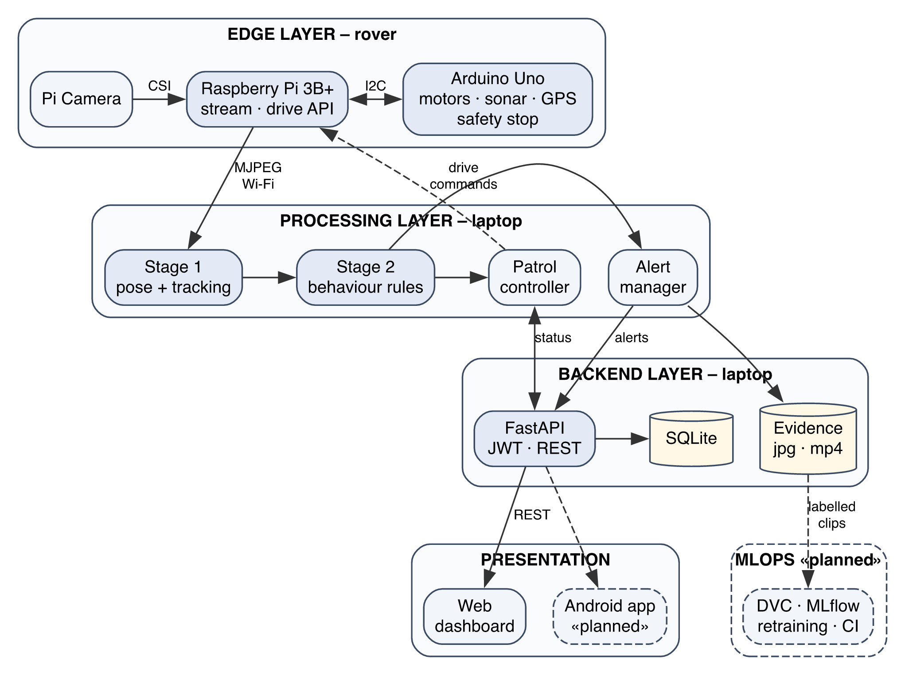
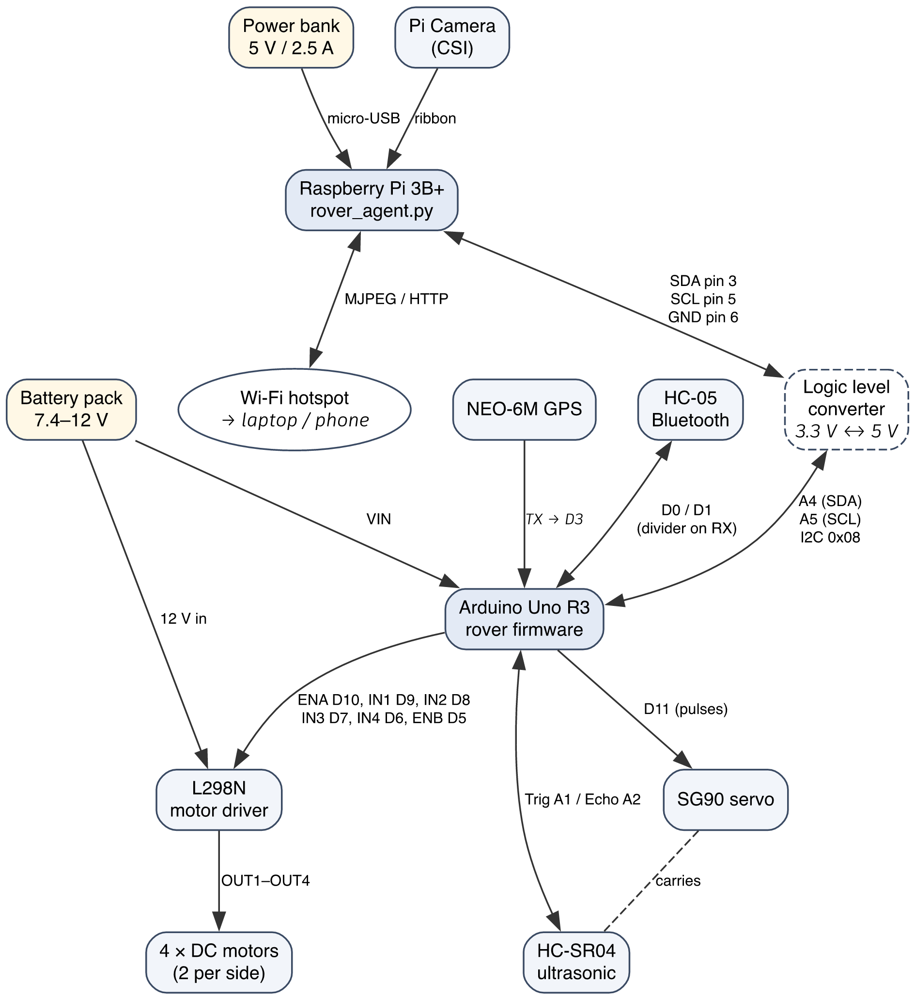

# Complete Setup Guide: from wires to a working surveillance rover

This is the **one guide** to follow, top to bottom. Every step ends with a ✅ check: don't go on until it passes.

How everything works, and how to **demonstrate it with videos instead of real people**: `HOW_IT_WORKS_AND_DEMO.md`.

| Part | What | Time |
|---|---|---|
| **A** | How it fits together | 5 min read |
| **B** | Wiring (hardware) | 1–2 h |
| **C** | Environments: laptop, Arduino, Raspberry Pi, network, room | 1.5 h |
| **D** | Trained AI model | 0 min (included) or ~2.5 h to retrain |
| **E** | First full run | 20 min |
| **F** | **Testing the physical rover**: bring-up checks once, then one full run | 1.5–2 h |
| **G** | The video demo (no real people needed) | – |
| **H** | Daily start / stop checklist | – |
| **I** | Troubleshooting | – |

---

# Part A: How it fits together



```
Pi Camera ─► Raspberry Pi 3B+ ──Wi-Fi──► Laptop: AI detection + patrol brain + backend ──► Phone / browser dashboard
                  │ I2C (address 0x08)
                  ▼
             Arduino Uno ─► L298N ─► 4 DC motors
                  ├─ HC-SR04 sonar on SG90 servo (obstacles)
                  ├─ NEO-6M GPS (location, outdoors only)
                  └─ HC-05 Bluetooth (optional manual driving)
```

Who does what:

| Device | Job | Program |
|---|---|---|
| **Arduino Uno** | Motors, sonar, servo, GPS, Bluetooth. **Stops the motors by itself** at 25 cm from an obstacle, and after 3 s without a new command | `firmware/rover_arduino/rover_arduino.ino` |
| **Raspberry Pi 3B+** | Streams the camera over Wi-Fi; passes drive commands to the Arduino. **No AI here** (too slow) | `rover/rover_agent.py` |
| **Laptop** | All AI (YOLO11n-pose, ByteTrack, trained fight model, rules), patrol decisions, backend + dashboard | `run.py`, `python -m backend` |
| **Phone** | Dashboard in the browser: live view, alerts with clips, Patrol/Guard/drive buttons | (browser) |

---

# Part B: Wiring

The hardware is wired as in the reference report (`ProjectMain_StudentName_123BS14.pdf`, Figures 3.1 and 3.2), with **two corrections** marked ⚠️. Where the tables below and the reference report disagree, follow the tables.



## B.1 Build order (do it in this order, power OFF)

1. Mount the 4 motors, the L298N, the Arduino, the breadboard and the battery holder on the chassis.
2. Mount the servo at the front and the HC-SR04 on the servo horn, so the servo can turn it left and right.
3. Mount the Pi and the power bank on the top deck, and the camera at the front (see C.5.2 for the tilt).
4. Wire the motors → L298N → Arduino (B.2).
5. Wire the sensors (B.2).
6. Wire the Pi ↔ Arduino I2C (B.3).
7. Do the **power-off checks** (B.5) **before** connecting any battery.

## B.2 Arduino Uno connections

| From | To Arduino | Notes |
|---|---|---|
| L298N **ENA** | **D10** | remove the ENA jumper cap (otherwise there's no speed control) |
| L298N **IN1** | **D9** | |
| L298N **IN2** | **D8** | |
| L298N **IN3** | **D7** | |
| L298N **IN4** | **D6** | |
| L298N **ENB** | **D5** | remove the ENB jumper cap |
| SG90 servo signal (orange) | **D11** | servo red → 5V, brown → GND |
| HC-SR04 **Trig** | **A1** | VCC → 5V, GND → GND |
| HC-SR04 **Echo** | **A2** | |
| GPS **TX** | **D3** | ⚠️ the reference text and picture disagree; use **D3**. GPS VCC → **3.3V**, GND → GND. GPS RX → D2 (optional, unused) |
| HC-05 **TXD** | **D0 (RX)** | |
| HC-05 **RXD** | **D1 (TX)** through a divider | Arduino D1 → 1 kΩ → HC-05 RXD; HC-05 RXD → 2 kΩ → GND. HC-05 VCC → 5V, GND → GND |
| Battery **+** (7.4–12 V) | Arduino **VIN** and L298N **12V** terminal | through the rover's power switch |
| Battery **−** | Arduino **GND** and L298N **GND** | **all grounds must be joined** |

**Motors:** left pair → L298N OUT1/OUT2, right pair → OUT3/OUT4 (the two motors on one side in parallel). If a direction comes out wrong, you fix it in software (C.2 step 8), not by rewiring.

**Don't** join the L298N's 5V pin to the Arduino's 5V pin when the Arduino is powered through VIN: two regulators would fight each other. Only the grounds are shared.

## B.3 Raspberry Pi ↔ Arduino (I2C)

⚠️ The reference text says "GPIO 2 → SCL". That's **backwards**: GPIO 2 is **SDA**. The reference picture (Figure 3.2) shows an Arduino **Mega**, whose SDA/SCL pins are 20/21. On your **Uno** they are **A4/A5**.

| Raspberry Pi (physical pin number) | Arduino Uno |
|---|---|
| Pin 3 (GPIO 2, **SDA**) | **A4** (SDA) |
| Pin 5 (GPIO 3, **SCL**) | **A5** (SCL) |
| Pin 6 (**GND**) | **GND** |

Physical pin 1 is the corner pin nearest the SD card slot on the inner row; pin 3 is next to it going away from the slot; pin 5 is next after that. Pin 6 is on the outer row, opposite pin 5.

**With a logic level converter (recommended: it protects the 3.3 V Pi from the 5 V Arduino):**

| Converter pin | Connect to |
|---|---|
| LV | Pi pin 1 (3.3 V) |
| HV | Arduino 5V |
| GND (both sides) | Pi pin 6 and Arduino GND |
| LV1 / HV1 | Pi pin 3 / Arduino A4 |
| LV2 / HV2 | Pi pin 5 / Arduino A5 |

Without a converter it usually still works (the Pi's pull-ups hold the lines near 3.3 V), but that's slightly outside the Pi's specification.

## B.4 Power and camera

- **Pi:** powered from the **power bank** (micro-USB, 5 V, at least 2.5 A). **Never** from the motor battery.
- **Camera:** ribbon cable into the Pi's **CAMERA** connector (between HDMI and audio). The blue side faces the Ethernet/USB ports. Close the latch.
- **Arduino + motors:** from the battery (7.4–12 V) through a switch.

## B.5 Power-off checks (with a multimeter, before any battery is connected)

| Check | How | Must read |
|---|---|---|
| No short on the battery input | Continuity between battery + and − wires | **no beep** |
| No short on 5V | Continuity between Arduino 5V and GND | **no beep** |
| Grounds joined | Continuity between Arduino GND, L298N GND, Pi pin 6 | **beep** |
| I2C lines correct | Continuity Pi pin 3 ↔ A4 (or via converter LV1/HV1), pin 5 ↔ A5 | **beep** |
| GPS on 3.3 V | Follow the GPS VCC wire | goes to **3.3V**, not 5V |

✅ **Check B:** all five checks pass. Then connect the battery with the rover **lifted** (wheels in the air): the Arduino and L298N LEDs light up, nothing gets hot, and there's no smell. Connect the power bank: the Pi's red LED is on and the green LED flickers.

---

# Part C: Environments

There are five environments to prepare: the **laptop** (C.1), the **Arduino** (C.2), the **Raspberry Pi** (C.3), the **network** (C.4) and the **room** you'll test in (C.5).

## C.1 Laptop (macOS or Windows)

1. Install **Python 3.10 or 3.11** (python.org) and **Git**.
2. Get the code and make a virtual environment:
   ```bash
   git clone <your-repo-url> "Ahmad Rover"
   cd "Ahmad Rover"
   python3 -m venv .venv
   source .venv/bin/activate            # Windows: .venv\Scripts\activate
   pip install -r requirements.txt
   ```
3. The two pretrained YOLO models (`models/yolo11n-pose.pt`, `models/yolo11n.pt`, about 11 MB) download automatically the first time you run the app. The **trained fight model** (`models/fight_gru.pt` + `fight_gru.json`) is already in the repository (see Part D).
4. Get the test videos (used for software tests): `python tools/get_test_videos.py`

✅ **Check C.1:** `python run.py --source tests/videos/fight.avi --set loitering.enabled=false` opens a window. The terminal prints `Fight detection: trained model fight_gru.pt`, and the two fighters turn red with **FIGHT**.

Every new terminal needs `cd "Ahmad Rover"` and `source .venv/bin/activate` first.

## C.2 Arduino

1. Install **Arduino IDE 2** on the laptop.
2. **Tools → Manage Libraries**, search **TinyGPSPlus** (by Mikal Hart), click **Install**.
3. Open `firmware/rover_arduino/rover_arduino.ino`.
4. **Tools → Board → Arduino Uno**. Plug in the USB cable, then pick the port under **Tools → Port**.
5. **Unplug the HC-05's two wires from D0/D1** (otherwise the upload fails), then click **Upload**.
6. Plug the HC-05 wires back in.
7. **Tools → Serial Monitor**, 9600 baud, press the Arduino's reset button.

✅ **Check C.2:** the Serial Monitor shows `ROVER READY` and the servo moves to the centre.

8. **If a direction is wrong later** (found in test F.1.3), change these lines at the top of the sketch and upload again:

   | Problem | Change |
   |---|---|
   | One side turns backwards on `F` | `INVERT_A = true` (or `INVERT_B`) for that side |
   | `L` spins right and `R` spins left | `SWAP_SIDES = true` |

## C.3 Raspberry Pi

**C.3.1 Operating system**
1. On the laptop, install **Raspberry Pi Imager**.
2. Choose **Raspberry Pi 3** → **Raspberry Pi OS Lite (64-bit)** → your microSD card (16 GB or more).
3. Click **Edit settings**:
   - Hostname: `rover`
   - Username `pi`, plus a password of your choice
   - Wi-Fi: your **hotspot's** name and password (C.4)
   - Services: **Enable SSH** (password login)
4. Write the card, put it in the Pi, power on, and wait 2 minutes.
5. On the laptop (connected to the same hotspot): `ssh pi@rover.local`

✅ **Check C.3.1:** you get a `pi@rover:~ $` prompt. If `rover.local` isn't found, use the Pi's IP address from the hotspot's list of connected devices.

**C.3.2 Packages, I2C and camera** (on the Pi)
```bash
sudo raspi-config nonint do_i2c 0
sudo apt update
sudo apt install -y python3-picamera2 python3-opencv i2c-tools
sudo apt install -y python3-smbus2 || pip3 install --break-system-packages smbus2
echo "dtparam=i2c_arm_baudrate=50000" | sudo tee -a /boot/firmware/config.txt
sudo reboot
```
The last line slows I2C down to 50 kHz, which makes the link to the Arduino more reliable. (On older systems the file is `/boot/config.txt`.)

**C.3.3 Copy the rover program** (on the **laptop**, in the project folder)
```bash
scp -r rover pi@rover.local:~/
```

✅ **Check C.3:** after the reboot, `ssh pi@rover.local` works again, and `ls ~/rover` shows `rover_agent.py  i2c_test.py  rover-agent.service`.

## C.4 Network

The laptop, the Pi and the phone must be on the **same Wi-Fi**, and that Wi-Fi must let devices talk to each other. University Wi-Fi usually blocks this, so use:

- a **phone hotspot** (simplest; use a second phone for the dashboard), or
- a **pocket router / home router**.

Write down the laptop's IP on that network: macOS `ipconfig getifaddr en0`, Windows `ipconfig`. The backend also prints it when it starts.

✅ **Check C.4:** from the laptop, `ping rover.local` gets replies.

## C.5 The room (physical environment)

**C.5.1 Area and boundaries**

| | Size |
|---|---|
| Camera sees people well at | **1.5 m to about 6 m** |
| One 4-direction look covers | a circle of about **5–6 m radius** |
| **Recommended patrol area** | one room or corridor, **5 × 5 m to 8 × 8 m** (a classroom or lab) |
| Demo area | about **3 × 4 m** of clear floor with a few boxes, plus a table or floor spot for the demo screen (`HOW_IT_WORKS_AND_DEMO.md` 4.4) |

The rover has no map and GPS doesn't work indoors, so **the walls are the boundary**:

- Use a **closed area**: a room with the door shut, or block open sides with **cardboard boxes at least 20 cm tall** (the sonar is low).
- **Hard, flat** surfaces at the edges. The sonar misses curtains, sofas and thin chair legs, so put boxes in front of those.
- ⚠️ **No stairs or drops** anywhere near: the sonar looks forward, not down.
- A smooth floor (tiles or wood), so turns are repeatable.
- **Good, even light** for patrol. For the screen demo, dim the lights and avoid reflections on the screen.

**C.5.2 Camera height and tilt**

The camera is about 15 cm above the floor. For the video demo, point it **straight ahead** and put the screen at camera height. For real people (later, outdoors or in a corridor) it would only see legs, so it would need to be tilted up about 20° or raised on a 30–50 cm mast. This is checked in test F.5.3.

---

# Part D: The trained AI model

The fight detector is a **trained neural network**, not hand-set thresholds:

- **Model:** a small GRU (`models/fight_gru.pt`) that reads the skeletons of two nearby people over 2 seconds and outputs the probability that they are fighting.
- **Trained on:** RWF-2000 (1,600 real CCTV clips). Tested on 400 clips it never saw. The numbers are in `models/fight_gru.json` and `reports/fight_metrics.json`.
- **Switch:** `config.yaml` → `fight.method: model`. Use `rules` for the old thresholds. If the model file is missing, the app falls back to the rules automatically.

You **don't need to retrain** to use the rover. To retrain or improve it (for example with your own rover recordings), follow `docs/TRAINING.md`. In short:
```bash
python training/extract_pose.py      # videos -> skeletons (about 2 h for RWF-2000)
python training/train_fight.py       # skeletons -> model + metrics + plots (a few minutes)
```

Loitering (time in view), restricted zones (an area you draw) and stealing (a guarded object moved after a hand touch) remain **rules**. Loitering and zones are *settings the operator chooses*, so there's nothing to learn from data. For stealing, no public dataset matches the rover's view; your labelled rover recordings (F.7) are what a future stealing model would be trained on.

---

# Part E: First full run

**E.1 Laptop settings.** Edit `config.yaml`:
```yaml
rover:
  url: http://rover.local:8000     # or http://<pi-ip>:8000
  token: MY-SECRET-123             # make one up; the Pi must use the same
backend:
  url: http://localhost:8080
  device_token: <make up a long random string>
```
Delete old zones drawn on the laptop webcam (`zones.json`); they don't fit the rover's camera.

**E.2 Start the Pi agent** (on the Pi):
```bash
cd ~/rover && python3 rover_agent.py --token MY-SECRET-123
```
When F.3 passes, install it as a service so it starts on boot (F.3.5).

**E.3 Create your dashboard login** (laptop, once): `python -m backend.manage create-user admin`

**E.4 Run** (laptop, two terminals):
```bash
# Terminal 1: backend + dashboard
python -m backend                  # prints the dashboard address, e.g. http://192.168.43.20:8080

# Terminal 2: detection + rover control
python run.py --mode manual        # first runs: manual, so it only moves when you drive it
```
Normally (`python run.py` without `--mode`) the rover **starts patrolling by itself** as soon as the camera and AI are ready (`rover.start_mode: patrol`). How it behaves is explained in `HOW_IT_WORKS_AND_DEMO.md` Part 2.

**E.5 Controls**

| Key (detection window) | Dashboard button | Action |
|---|---|---|
| G | Patrol | start patrolling |
| H | Guard (parked) | stay still and watch one scene (restricted zones only work here) |
| M | Manual | move only when you drive it |
| W / A / S / D | ▲ ◀ ▼ ▶ | forward / turn left / back / turn right |
| Space | ■ | stop |
| Z, click the corners, Enter | – | draw a restricted zone (guard mode) |
| C | – | clear the zones |
| V | – | show debug values |
| Q | – | quit (the rover stops) |

---

# Part F: Testing the physical rover, step by step

You **don't** have to test every feature separately:

- **F.1–F.4 are bring-up checks.** Do them **once**, while building, only to catch wiring mistakes. Each takes a few minutes. If something works later, you don't need to repeat them.
- **F.5 is a quick check** that the whole chain works.
- **F.6 is one full run** with the demo video: it shows and checks every activity and the rover's behaviour in one 15-minute session. **No real people need to act.**

Take a photo or short phone video of the passed hardware checks and of the full run; they go in the final report. **Wheels OFF the ground** (rover on a box) for F.1 and F.3, unless it says "on the floor".

The test IDs in brackets (TC-xx) match `docs/TESTING.md` and the report's test table.

## F.1 Arduino alone (USB cable to the laptop, battery on)

| # | Do | Pass if | If it fails |
|---|---|---|---|
| F.1.1 (TC-17) | Open the Serial Monitor (9600), press reset | `ROVER READY` and the servo centres | Re-upload (C.2); check the servo signal is on D11 |
| F.1.2 | Type `S` + Enter | Nothing moves (stop works) | – |
| F.1.3 (TC-18) | Type `F`, `B`, `L`, `R`, one at a time | All wheels forward / all back / left side back + right side forward / the opposite. Each move lasts ≈0.3 s | Fix with the flags in C.2 step 8; a side that never turns: check the ENA (D10) / ENB (D5) wires and the OUT terminals |
| F.1.4 (TC-20) | Type `2` then `F`, then `9` then `F` | Slow, then clearly faster | ENA/ENB not on D10/D5 |
| F.1.5 (TC-19) | Hold your hand **15 cm** in front of the sonar, type `F` | Wheels **refuse** to go forward; `B` still works | Trig/Echo swapped (A1/A2), or sonar not on 5V |
| F.1.6 | Hand at 50 cm, type `F` | Wheels go forward | – |
| F.1.7 (TC-21, optional) | Pair your phone with the HC-05 (PIN `1234` or `0000`), use a "Bluetooth RC Car" app | App buttons drive the wheels | TX/RX swapped; divider missing |
| F.1.8 (TC-22, outdoors) | Leave the rover under open sky 5 minutes | The GPS LED blinks (it has a fix). The value is read in F.3.3 | Normal indoors: no fix |

## F.2 Raspberry Pi alone (power bank, no Arduino needed)

| # | Do | Pass if | If it fails |
|---|---|---|---|
| F.2.1 (TC-23) | `ssh pi@rover.local` | Prompt appears | Same hotspot? Use the IP address |
| F.2.2 (TC-24) | `rpicam-hello --list-cameras` | Camera listed | Ribbon cable direction / latch; reboot |
| F.2.3 (TC-25) | `cd ~/rover && python3 rover_agent.py --fake --token X`, then open `http://rover.local:8000/?token=X` on the laptop | Live camera in the browser | Agent error in the terminal; port in use |
| F.2.4 (TC-26) | Watch it for 2 minutes | Smooth (≈15 fps), no freezing | Weak hotspot signal; power bank too weak (lightning icon / under-voltage warning) |

## F.3 Pi + Arduino together

| # | Do | Pass if | If it fails |
|---|---|---|---|
| F.3.1 (TC-27) | On the Pi: `i2cdetect -y 1` | **08** appears in the table | SDA/SCL swapped (B.3), GND missing, I2C not enabled (C.3.2), firmware not uploaded |
| F.3.2 (TC-28) | `cd ~/rover && python3 i2c_test.py`, press Enter between steps | Status read OK; F/B/L/R each correct for 1 s; the servo sweeps and 3 distances are printed; live distance follows your hand | "No answer": as F.3.1; try again once (the first read after a reset can fail) |
| F.3.3 | Same output, outdoors after F.1.8 | `gps_fix=True` and satellites ≥ 4 | Indoors: expected |
| F.3.4 (TC-29) | `python3 rover_agent.py --token MY-SECRET-123` (no `--fake`), open `http://rover.local:8000/?token=MY-SECRET-123` | Video + arrow buttons drive the wheels; `http://rover.local:8000/status` shows a changing `distance_cm` | Token mismatch; I2C as above |
| F.3.5 (TC-31) | Install the service: `sudo cp ~/rover/rover-agent.service /etc/systemd/system/`, then `sudo nano /etc/systemd/system/rover-agent.service` (put your token after `--token`), then `sudo systemctl daemon-reload && sudo systemctl enable --now rover-agent`, then `sudo reboot` | One minute after reboot the browser page from F.3.4 works without logging in | `journalctl -u rover-agent -f` shows the error |

## F.4 On the floor (still without the laptop AI)

Put the rover on the floor in the test room (C.5). Use the browser page from F.3.4, or `tools/rover_drive.py` from the laptop.

| # | Do | Pass if | If it fails |
|---|---|---|---|
| F.4.1 | Drive forward 2 s, back, left, right | Moves straight-ish; turns in place | Pulls hard to one side: check wheels and motor wiring. Too weak: raise `rover.speed` |
| F.4.2 (TC-11) | Drive towards a wall from 2 m | **Stops by itself ≈25 cm from the wall** | Sonar angle (must point straight ahead); sonar on 5V |
| F.4.3 | Repeat F.4.2 towards a cardboard box, a chair leg and a curtain | Box: stops. Chair leg and curtain: note the result (expected limitation) | Put boxes in front of things the sonar misses |
| F.4.4 | Laptop: `python tools/rover_drive.py right 700` | Note the angle turned. Change 700 until it's **≈90°**; put the value in `config.yaml` → `rover.turn_90_ms` | Redo after charging; battery level changes it |
| F.4.5 | `python tools/rover_drive.py right <your value>` four times | Ends facing the starting direction (±20°) | Fine-tune `turn_90_ms` |
| F.4.6 | `python tools/rover_drive.py scan` | The servo looks left/centre/right and prints 3 distances that match reality (±5 cm) | – |
| F.4.7 (TC-30) | While driving forward, switch off the laptop's Wi-Fi | The rover **stops within 3 s** on its own | Firmware: every move times out (MAX_DRIVE_MS) |

## F.5 Full system: rover + laptop AI + phone

Start everything as in Part E (Pi service running, `python -m backend`, `python run.py --mode manual`). Log in on the phone. Make the demo reel once (`python tools/make_demo_reel.py`) and play it on a second screen (TV, monitor, tablet or laptop) about 1 m in front of the rover, at camera height (`HOW_IT_WORKS_AND_DEMO.md` 4.4).

| # | Do | Pass if | If it fails |
|---|---|---|---|
| F.5.1 (TC-32) | Look at the detection window | Rover's live camera with a yellow status line: `ROVER MANUAL … sonar NN cm`, FPS ≥ 7 | "Waiting for rover video": wrong `rover.url`, Pi agent not running, different Wi-Fi |
| F.5.2 (TC-33) | Drive with **W/A/S/D**, stop with **Space** | Rover follows within ~0.5 s | "rover offline" in the status line: token mismatch |
| F.5.3 (TC-35) | Play the demo reel on the screen in front of the rover | The people on the screen get **skeletons** | Move the screen closer; brighter screen; no reflections; dim the room |
| F.5.4 (TC-39) | On the phone, press ▲, ◀, ■, then **Guard**, then **Manual** | Rover obeys within ~1–2 s; the window shows the new mode | Phone on a different Wi-Fi; `backend.url` not set |
| F.5.5 | Phone: watch the live view while the reel plays | Annotated video on the phone | `backend.url` not set |
| F.5.6 (TC-36) | Press **H** (guard). Press **Z**, click 4 corners of an area of the picture, Enter; **C** clears it | Red zone drawn | – |
| F.5.7 (TC-37) | Empty closed room: press **G** (patrol), watch for **5 minutes** | Drives in short steps, stops and looks in 4 directions, turns away from walls, **never hits anything, never leaves the area** | Hits things: the sonar misses them (F.4.3), so add boxes. Turns wrong: recalibrate (F.4.4) |
| F.5.8 (TC-38) | During patrol, let the rover face the screen while the reel shows people | Rover **stops and watches** (status `watching people`); resumes ≈5 s after the people disappear | – |
| F.5.9 | Put a box in its path (nothing on the screen) | Stops ≈25 cm before it, looks 1.5 s, turns toward the free side | Sonar angle; `turn_90_ms` (F.4.4) |
| F.5.10 | Put the screen with people **right in front** of the rover | Stops and **stays** (`something in front: recording the scene`); doesn't turn away | – |

## F.6 One full run: the whole system, with the demo video

This replaces separate scenario tests with real people. Follow the **13-step full run** in `HOW_IT_WORKS_AND_DEMO.md` section 4.5. In short:

| Part of the run | Shows | Pass if |
|---|---|---|
| Patrol in a room with boxes (2 min) | wandering, obstacle avoidance | never hits anything, turns toward free space |
| Screen with people in front | scene vs. obstacle | stops and watches; stays when the screen is right in front |
| Guard mode, reel scenes 1–3 (TC-40…TC-42) | normal, fighting, loitering, restricted zone | no alert on normal; FIGHT, LOITERING and UNAUTHORISED ACCESS alerts on the right scenes |
| Patrol mode, reel scene 2 again | alert handling | rover holds position 20 s after the alert |
| Stealing scene, optional (TC-45) | stealing | STEALING alert |
| Phone (TC-47) | alerts and control | snapshot and playable clip for each alert; mode buttons work |
| Hotspot off 10 s (TC-49) | safety | rover stops by itself |

Run it with `python run.py --set loitering.seconds=10` (shorter loitering time for the demo). If the fight scenes are missed, lower `fight.model_threshold` (for example 0.6) and repeat. If normal scenes give fight alarms, raise it. Write down the value you end with.

## F.7 Measurements and recordings for the report

| # | Measure | How |
|---|---|---|
| F.7.1 (TC-14) | FPS while the reel shows several people | Read FPS in the window; note min / typical |
| F.7.2 (TC-55) | Video delay Pi → laptop | Show a phone stopwatch to the rover camera; photograph it next to the detection window |
| F.7.3 (TC-54) | Event → phone delay | Film the screen (fight scene) and the phone together with a second phone; count frames from the first punch to the phone pop-up |
| F.7.4 (TC-57) | Battery life | Full charge → patrol until it stops moving reliably |
| F.7.5 (TC-58) | Patrol coverage | 10 minutes of patrol: mark the rover's path on a floor sketch |
| F.7.6 (optional) | Record footage for retraining | `python run.py --record outputs/<name>.mp4` saves the raw camera video; label clips as Fight / NonFight (`docs/TRAINING.md` section 8) |

Then fill the results table at the end of `docs/TESTING.md` (per reel scene: expected, detected, missed, false alarms).

---

# Part G: The video demo (no real people needed)

The rover is small, and staging fights with real people is unsafe. So every activity is shown with **video played on a screen in front of the rover's real camera**. The camera, Pi, AI, alerts, phone and rover behaviour are all real.

| Activity | Shown with | Alert |
|---|---|---|
| Normal (no alert) | reel scene 1: RWF-2000 test clips of people close together | – |
| Fighting | reel scene 2: 4 RWF-2000 **test** clips (never used for training) | FIGHT within ≈2–3 s |
| Loitering | reel scene 3: pedestrian video | LOITERING after 10 s (demo setting) |
| Restricted zone | reel scene 3, guard mode, zone drawn on the road | UNAUTHORISED ACCESS on entry |
| Stealing (optional) | your own phone clip of a hand taking a bag (`--stealing`) | STEALING |

Making the reel, setting up the screen, the full run, the backup plan and what to tell the examiners: `HOW_IT_WORKS_AND_DEMO.md` Part 4.

---

# Part H: Daily start / stop checklist

**Start**
1. Charge the motor battery and the power bank.
2. Hotspot on. Connect the laptop and the phone.
3. Power the rover (battery switch + power bank). Wait 1 minute for the Pi.
4. Laptop terminal 1: `python -m backend`
5. Laptop terminal 2: `python run.py`. Check you see the camera and the sonar value. The rover **starts patrolling by itself** once the camera and AI are ready.
6. Phone: open the dashboard and log in.
7. Recalibrate `turn_90_ms` if the floor or battery changed (F.4.4).
8. Leave it patrolling, or park it and press **Guard** (phone or **H**).

**Stop**
1. **Q** in the detection window (the rover stops). Ctrl+C in the backend terminal.
2. `ssh pi@rover.local sudo poweroff`, wait 20 s, then unplug the power bank.
3. Switch off the motor battery.

Alerts, snapshots and clips stay in `alerts/` and in the dashboard history.

---

# Part I: Troubleshooting

| Problem | Fix |
|---|---|
| Arduino upload fails | Unplug the HC-05 wires from D0/D1 |
| Arduino resets when the servo or motors move | Weak battery; power the servo from the L298N's 5V output instead of the Arduino's (grounds joined) |
| `i2cdetect` doesn't show 08 | SDA→A4, SCL→A5, GND joined; I2C enabled (C.3.2); firmware uploaded |
| `i2c_test.py`: "No answer" | As above; run it once more |
| Wheels turn the wrong way | Flags in C.2 step 8 |
| `ssh pi@rover.local` not found | Use the Pi's IP from the hotspot's device list |
| "Waiting for rover video" | Pi agent not running (`sudo systemctl status rover-agent`), wrong `rover.url`, laptop on a different Wi-Fi |
| Rover doesn't move from the laptop | Token in `config.yaml` ≠ the Pi's `--token`; the status line says "rover offline" |
| Dashboard won't open on the phone | Same hotspot? Use the IP printed by `python -m backend`; on macOS allow incoming connections for Python |
| Dashboard has no live video | `backend.url` not set in `config.yaml` |
| Terminal says "fight_gru.pt not found, using hand-tuned rules" | The model files are missing from `models/`; get them from the repository or retrain (`docs/TRAINING.md`) |
| Too many / too few fight alerts | Adjust `fight.model_threshold` (F.6) |
| People not detected | More light; people at 2–4 m; camera tilt (C.5.2) |
| Rover turns too far / not enough | Recalibrate `turn_90_ms` (F.4.4) |
| GPS always "no fix" | Normal indoors; outdoors it needs open sky and 1–5 minutes |
