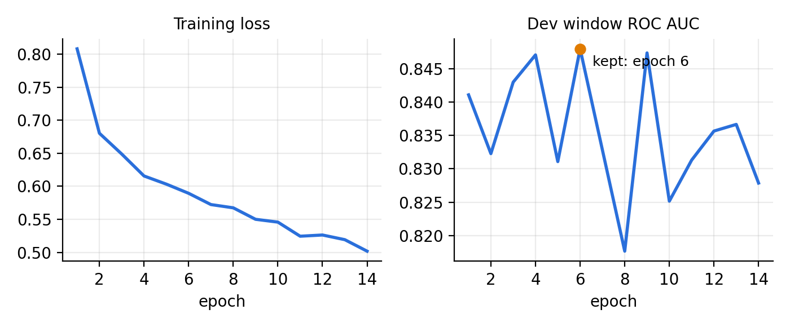
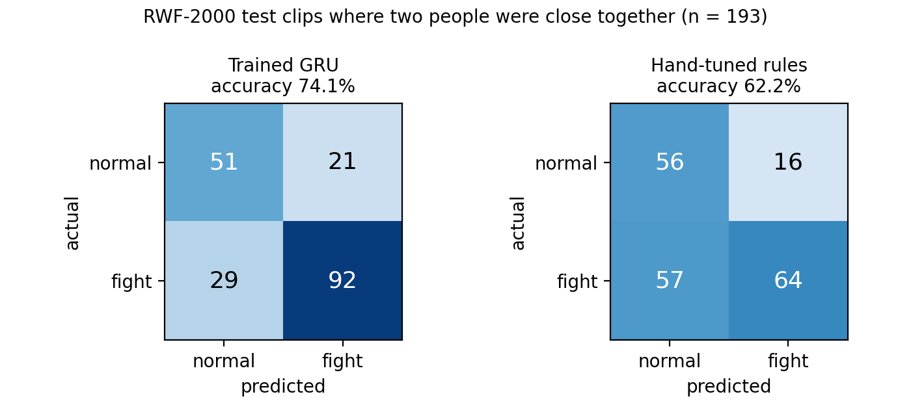

# Training the fight model (MLOps pipeline)

The fight detector is a **trained model**: a small GRU neural network that reads the skeletons of two nearby people over 2 seconds and outputs the probability that they are fighting. This page explains what it learns from, how to retrain it, and how to add your own rover recordings.

## 1. The pipeline

```
RWF-2000 videos ──► 1. extract_pose ──► skeletons (.npz) ──► 2. train_fight ──► models/fight_gru.pt + .json
 (12 GB archive)     YOLO11n-pose +       one file per clip      GRU, threshold,     reports/fight_metrics.json
                     ByteTrack, 10 fps                           test, rules compare reports/*.png
```

| Stage | Script | Input | Output | Time (laptop CPU) |
|---|---|---|---|---|
| 0. Get data | `curl` (below) | – | `data/rwf/RWF-2000.tar.gz` (12 GB) | ~7 min |
| 1. Extract skeletons | `training/extract_pose.py` | the archive | `data/rwf/pose/<split>/<Fight\|NonFight>/*.npz` | ~2 h |
| 2. Train + evaluate | `training/train_fight.py` | the skeletons + `params.yaml` | model, metrics, plots | ~9 min (incl. 5-fold CV) |

The settings live in `params.yaml`. `dvc.yaml` describes the same two stages for **DVC**, so `dvc repro` re-runs only what changed. If **MLflow** is installed, each training run is logged to `mlruns/` (view with `mlflow ui`).

## 2. Why skeletons, not pixels

Stage 1 turns every clip into the **same skeletons the live system sees** (same YOLO11n-pose, same ByteTrack tracker, same 10 fps). So the model learns from exactly the kind of input it gets on the rover. Skeletons also ignore background, clothing and camera, which matters because RWF-2000 was filmed by fixed CCTV and the rover's camera is low and moving. And they are tiny, so the GRU trains in minutes on a CPU.

## 3. What one training sample is

- **Two people** who are close to each other (closer than 3.5 body-widths, the same rule used live).
- **20 frames = 2 seconds** at 10 fps.
- For each person and frame:
  - the position of all 17 keypoints relative to the pair's centre, divided by body width;
  - which keypoints are visible;
  - how fast each keypoint moves **relative to that person's own body** (walking moves the whole body and cancels out; punching moves arms against the body).
- For the pair: the distance between the two people and how fast it changes.
- That's **174 numbers per frame**, so one sample is a 20 × 174 table.
- **Label:** 1 if the clip is from RWF-2000 `Fight`, 0 if from `NonFight`.

**Augmentation** (more variety from the same data): mirror left/right, swap which person is "A", and add small random noise.

## 4. The model

```
20 × 174 ──► Linear 174→64 + ReLU ──► GRU (2 layers, 64) ──► [last state, average state] ──► 64 ──► 1 ──► sigmoid = P(fight)
```

About 69,000 parameters (a few hundred KB). One evaluation takes about 1 ms on the CPU.

**Live**, for every close pair of people in every frame: resample their last 2 s of skeletons to 10 fps, run the model in both person orders and average. Then alert when the pair's **last few judgements are all above the threshold** (how many, and the threshold, are chosen in training: see section 5). Detection flickers during fast movement, so a pair keeps this history through gaps of up to 1 s instead of starting again at every missed frame.

## 5. How it is trained and tested (no cheating)

| Data | Clips | Used for |
|---|---|---|
| RWF-2000 `train`, 5-fold cross-validation | 1,600 | choosing the **alert rule** (threshold + judgements in a row): each clip is scored by a model trained on the other 4 folds |
| RWF-2000 `train`, 90% / 10% ("dev") | 1,440 / 160 | fitting the final network / choosing its best epoch |
| RWF-2000 `val` | 400 | **final test only**: never seen during training or rule choice |

- **Loss:** binary cross-entropy (balanced for class sizes). **Optimiser:** AdamW, learning rate 0.001. **Batch:** 128.
- **Early stopping:** stop when the dev score hasn't improved for 8 epochs, and keep the best epoch.
- **Why cross-validation for the rule:** only clips where two people are detected close together can be affected by the threshold. In a 160-clip dev set that is about 65 clips, far too few to pick a threshold reliably. Cross-validation scores all 1,600 training clips (about 700 with a pair) without ever using the test set.
- **Clip-level test, scored the way it runs live:** a clip counts as "fight" if any close pair triggers the alert rule.
- **Baseline:** the same 400 test clips are replayed through the old hand-tuned rules, so both approaches are compared on identical data.

## 6. Results

Latest run (numbers from `reports/fight_metrics.json`).

**Alert rule chosen by 5-fold cross-validation:** 2 judgements in a row with probability ≥ **0.73**. With this rule, the out-of-fold accuracy on training clips with a close pair was 68.6% (F1 0.727).

**Final test on the 400 RWF-2000 `val` clips** (never used before this step), learned model vs. the old hand-tuned rules on the same clips:

| Metric | Learned, all 400 | Rules, all 400 | Learned, 193 with a pair | Rules, 193 with a pair |
|---|---|---|---|---|
| Accuracy | **67.8%** | 63.7% | **74.1%** | 62.2% |
| Precision | 81.4% | 81.6% | 81.4% | 80.0% |
| Recall (fights found) | **46.0%** | 35.5% | **76.0%** | 52.9% |
| F1 | **0.588** | 0.495 | **0.786** | 0.637 |
| ROC AUC | 0.667 | – | 0.771 | – |
| False alarms | 21 of 200 | 16 of 200 | 21 of 72 | 16 of 72 |

**How to read this:**
- The model finds clearly more fights than the rules (92 vs. 64 of 121 where a pair was visible) with a few more false alarms (21 vs. 16). Raise `model_threshold` if you want fewer alarms.
- **Coverage is the main limit.** Two nearby people were detected in only 193 of the 400 test clips (121 fight, 72 normal). RWF-2000 is dark, blurry, crowded, top-down CCTV, and the pretrained pose model often misses people there. No skeleton method can catch a fight it can't see. On the rover the camera is at person height and 2–4 m away, so people are much easier to detect.
- These are numbers for CCTV footage. Measure the rover's real performance with the acting tests in `SETUP_GUIDE.md` part F.6 and `TESTING.md`.

Plots: training curves (`reports/fight_training.png`), confusion matrices (`reports/fight_confusion.png`), ROC curve with the rules as a dot (`reports/fight_roc.png`).




## 7. Retraining, step by step

```bash
source .venv/bin/activate

# 0. data (once)
mkdir -p data/rwf
curl -L -C - -o data/rwf/RWF-2000.tar.gz https://huggingface.co/datasets/DanJoshua/RWF-2000/resolve/main/RWF-2000.tar.gz

# 1. skeletons (resumable: stop with Ctrl+C and run again to continue)
python training/extract_pose.py --archive data/rwf/RWF-2000.tar.gz --out data/rwf/pose --workers 3

# 2. train + evaluate
python training/train_fight.py
```

Or, with DVC installed (`pip install dvc`): `dvc repro`.

To try different settings, edit `params.yaml` (for example `window`, `hidden`, `epochs`) and run step 2 again. The new model replaces `models/fight_gru.pt`. Compare its numbers in `reports/fight_metrics.json` with the old ones before you keep it.

## 8. Adding your own rover clips (makes it better on the rover)

1. Record with the rover: `python run.py --record outputs/fight_01.mp4` (raw video, steady 10 fps).
2. Cut each recording into short clips (3–10 s) and sort them into folders:
   ```
   data/own/train/Fight/fight_01.mp4       data/own/train/NonFight/walk_01.mp4
   data/own/val/Fight/fight_09.mp4         data/own/val/NonFight/talk_04.mp4
   ```
   Put about 1 in 5 clips in `val`. Keep clips of the same people/session in the same split.
3. Extract the skeletons: `python training/extract_pose.py --folder data/own --out data/own/pose`
4. In `params.yaml`, set `extra_data: [data/own/pose]`.
5. Retrain: `python training/train_fight.py`.

The dashboard's **real / false alarm** labels tell you which alerts to turn into new `Fight` / `NonFight` clips. That's the retraining loop of the MLOps pipeline.

## 9. Using or switching off the model

`config.yaml`:
```yaml
fight:
  method: model              # or: rules  (the old hand-tuned thresholds)
  model: models/fight_gru.pt
  model_threshold: null      # null = the threshold chosen in training; lower = more sensitive
  model_consecutive: null   # null = the number chosen in training
```
If the model file is missing, the app prints a message and uses the rules.
